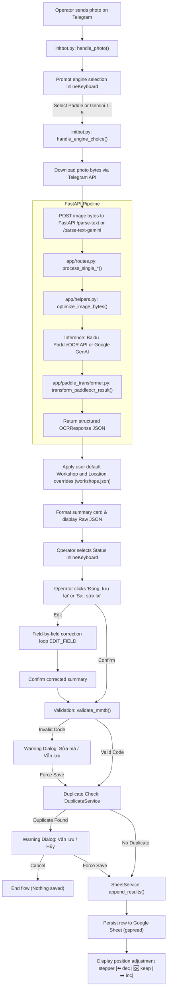
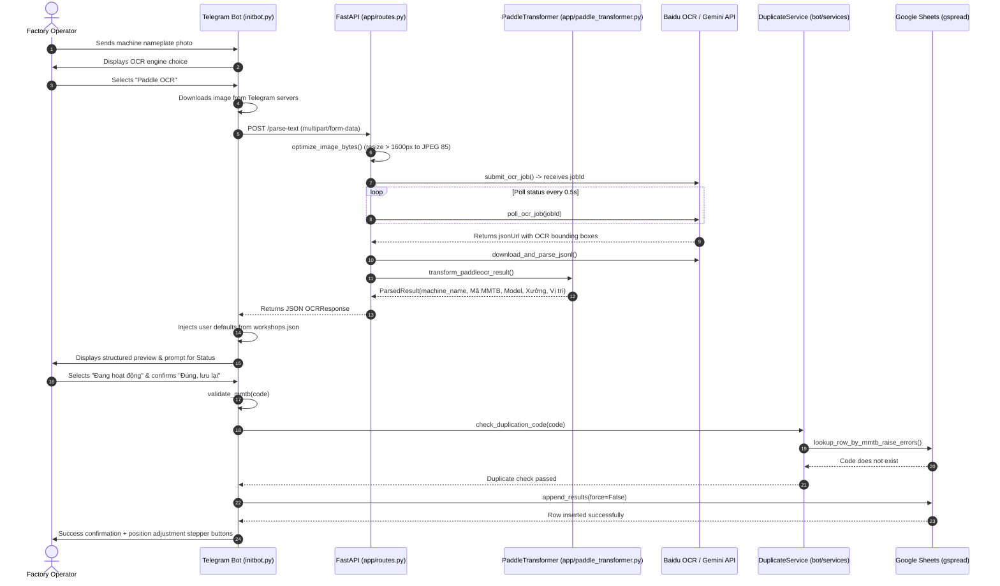

# Equipment OCR Telegram Bot (`eqparsing`)

An industrial nameplate digitisation assistant for Telegram. The bot captures photographs of machine nameplates, serial tags, and asset labels sent by factory operators, runs them through Optical Character Recognition (OCR — technology that converts text printed on physical objects into machine-readable digital text), cleans and validates the parsed specifications, and synchronises the inventory records directly into Google Sheets.

Designed for manufacturing engineers, maintenance teams, and equipment auditors (e.g., at industrial fabrication plants such as Đại Dũng, An Hạ, Long An, Miền Trung, Nghi Sơn, and Vũng Tàu), this service eliminates manual spreadsheet entry, enforces asset tag naming standards (`B########`), and guards against duplicate records.

---

## Table of Contents

- [1. Introduction](#1-introduction)
- [2. Features](#2-features)
- [3. Demo / Example Interaction](#3-demo--example-interaction)
- [4. Tech Stack](#4-tech-stack)
- [5. Project Structure](#5-project-structure)
- [6. Prerequisites](#6-prerequisites)
- [7. Step-by-Step Setup](#7-step-by-step-setup)
- [8. Running with Docker](#8-running-with-docker)
- [9. Full Logic Flow](#9-full-logic-flow)
- [10. OCR Pipeline Details](#10-ocr-pipeline-details)
- [11. Bot Commands and Handlers](#11-bot-commands-and-handlers)
- [12. Configuration Reference](#12-configuration-reference)
- [13. Testing and Diagnostics](#13-testing-and-diagnostics)
- [14. Troubleshooting / FAQ](#14-troubleshooting--faq)
- [15. Deployment Notes](#15-deployment-notes)
- [16. Contributing and Code Style](#16-contributing-and-code-style)
- [17. License and Maintainers](#17-license-and-maintainers)

---

## 1. Introduction

Industrial equipment management requires logging hundreds of physical asset tags attached to welding machines, lathes, milling centres, and cutting equipment. Manual data entry is prone to typos, slow, and frequently produces duplicate equipment entries or inconsistent naming conventions.

This project delivers a dual-service architecture:
1. **FastAPI OCR API Service (`app/`)**: A high-performance async REST backend that handles image preprocessing, communicates with Baidu AI Studio's PaddleOCR Cloud API or Google Gemini Multimodal APIs, and transforms unstructured text and bounding boxes into structured key-value maps.
2. **Telegram Bot Service (`initbot.py`)**: An interactive bot that lets shop-floor operators submit single photos or batches, configure workshop and column coordinates, review/edit field values, choose equipment operational states, check duplicates against Google Sheets, and update records in real time.

---

## 2. Features

### Core Capabilities Today
- **Single-Image OCR Mode ("📷 Đọc 1 hình")**: Send an individual tag photo, choose the OCR engine (PaddleOCR or Gemini 1–5), preview the structured card and raw JSON, pick operational status, review or correct fields interactively, and commit to Google Sheets.
- **Batch / Multi-Image OCR Mode ("📚 Đọc nhiều hình")**: Accumulate a queue of multiple label photos, trigger concurrent OCR (`asyncio.gather`), automatically evaluate validity, detect within-batch and sheet duplicates, and batch-save all valid items in a single click.
- **Factory & Workshop Hierarchy Selection (`/x`)**: An inline interactive wizard to configure factory facilities (e.g. An Hạ, Long An, Miền Trung, Nghi Sơn, Vũng Tàu), sub-workshops, and plant column coordinates (`A`–`F`, `1`–`25`).
- **Quick Location Adjustment (`/l [vị_trí]`)**: Set or update user default plant column coordinates instantly. After saving any record, the bot displays inline stepper buttons (`⬅️ dec`, `🆗 keep`, `➡️ inc`) to update location without typing.
- **Equipment Sheet Lookup & In-Place Editing (`/f [mã_mmtb]`)**: Look up existing machines in Google Sheets by ID code, display current parameters, and trigger field-by-field updates back into the existing sheet row.
- **Manual Equipment Addition (`/n`)**: Enter asset tags manually without a photo. Supports skipping unlabelled equipment, automatically storing `CHƯA CÓ MÃ`.
- **Equipment Code Validation**: Validates all asset IDs against the factory code standard (`^B\d{8}$` — capital letter `B` followed by exactly 8 digits). Warnings let users correct mistakes or intentionally force-save non-standard tags.
- **Sheet Duplicate Prevention**: Queries Google Sheets before persisting any record to prevent duplicate entries, warning the operator if a record with the same `Mã MMTB` already exists.

### Extracted Machine Tag Fields

| Field Name | Normalized Key | Example Values | Description |
|---|---|---|---|
| **Tên thiết bị** | `machine_name` | `MÁY HÀN CO2 TÂN THÀNH`, `MÁY TIỆN CNC` | Full equipment name, filtered from company branding |
| **Mã MMTB** | `Mã MMTB` | `B22401469`, `B21600137`, `CHƯA CÓ MÃ` | Unique equipment identifier code (`B########`) |
| **Model** | `Model` | `TTC-500T`, `MZ-1000`, `HAAS ST-10` | Model number or machinery specification |
| **Xưởng** | `Xưởng` | `AH6`, `Xưởng AH2`, `Phân xưởng 1` | Production workshop or department |
| **Vị trí** | `Vị trí` | `RHT1`, `B16`, `C12 (AH2)` | Plant column, grid coordinate, or line position |
| **Trạng thái** | `status` | `Đang hoạt động`, `Ngưng hoạt động`, `Đã thanh lý`, `Chưa dán tem` | Operational status selected by the operator |

### Output Format
- **Telegram Preview**: Clean Markdown card with emoji badges, execution timing, and expandable raw JSON inspection block.
- **Google Sheets Tabular Columns**:
  `[TÊN MMTB, Mã MMTB, MODEL, XƯỞNG, VỊ TRÍ, TRẠNG THÁI]`

---

## 3. Demo / Example Interaction

```text
User: [Sends image of welding machine nameplate]

Bot: 🖼️ Ảnh đã nhận! Chọn engine OCR để xử lý:
     [ 🔵 Paddle OCR ]
     [ ✨ Gemini gemini-2.5-flash-lite ]
     [ ✨ Gemini gemini-2.5-flash ]
     [ ✨ Gemini gemini-2.5-pro ]

User clicks: [ 🔵 Paddle OCR ]

Bot: ⏳ Đang xử lý với Paddle OCR...

Bot: 📋 Kết quả OCR — Paddle OCR
     ⏱ Thời gian xử lý: 2.145s

     🏷️ Tên thiết bị: MÁY HÀN CO2 TÂN THÀNH
     🔢 Mã MMTB: B22401469
     📦 Model: TTC-500T
     🏭 Xưởng: Xưởng AH6
     📍 Vị trí: B16
     ⚡ Trạng thái: —

Bot: 🗂️ Raw JSON:
     {
       "markdown": "MÁY HÀN CO2...",
       "key_value": { "machine_name": "...", "Mã MMTB": "B22401469", ... }
     }

Bot: ⚡ Chọn trạng thái thiết bị:
     [ 🟢 Đang hoạt động ]  [ 🔴 Ngưng hoạt động ]
     [ ⚠️ Đã thanh lý ]     [ 🏷️ Chưa dán tem ]

User clicks: [ 🟢 Đang hoạt động ]

Bot: ✔️ Đã chọn trạng thái: Đang hoạt động
     ❓ Thông tin trên có chính xác không?
     [ ✅ Đúng, lưu lại ]  [ ✏️ Sai, sửa lại ]

User clicks: [ ✅ Đúng, lưu lại ]

Bot: ⏳ Xin vui lòng đợi, để mình kiểm tra xem thông tin có bị trùng lặp không nhé!
     💾 Đang lưu dữ liệu vào Google Sheets...

Bot: ✅ Đã lưu thông tin thiết bị thành công.
     💡 Nhắc nhở: Đừng quên kiểm tra và cập nhật vị trí mặc định...
     [ ⬅️ B15 ]  [ 🆗 Giữ B16 ]  [ ➡️ B17 ]
```

---

## 4. Tech Stack

- **Language & Runtime**: Python 3.11 (tested on Python 3.11.9).
- **Web API Framework**: [FastAPI](https://fastapi.tiangolo.com/) (`>=0.100.0`) served by [Uvicorn](https://www.uvicorn.org/) (`>=0.22.0`).
- **Telegram Bot Framework**: [python-telegram-bot](https://github.com/python-telegram-bot/python-telegram-bot) (v20+ async architecture using `ApplicationBuilder`, `ConversationHandler`, `CallbackQueryHandler`, and persistent `ReplyKeyboardMarkup`).
- **OCR Engines**:
  - **PaddleOCR (Baidu AI Studio Cloud API)**: Invokes Baidu's managed PaddleOCR job endpoints (`https://paddleocr.aistudio-app.com/api/v2/ocr/jobs`) running `PaddleOCR-VL-1.6` / `PaddleOCR-VL-1.5`.
    > [!NOTE]
    > This codebase does **not** run local PaddlePaddle/CUDA binaries. All PaddleOCR inference is executed remotely in the cloud via HTTP polling, meaning no local GPU or CUDA setup is needed.
  - **Google Gemini API**: Multimodal inference via Google's `google-genai` SDK (`gemini-2.5-flash-lite`, `gemini-2.5-flash`, `gemini-2.5-pro`) with structured Pydantic schema validation (`EquipmentOCRResult`) and [tenacity](https://github.com/jd/tenacity) rate-limit retry policies. Supports up to 5 load-balanced / fallback client configurations.
- **Image Processing**: [Pillow](https://python-pillow.org/) (`PIL`) for MIME/format validation, image downsampling via `LANCZOS` (caps maximum dimension at 1600px), and JPEG re-encoding.
- **Data Storage & Persistence**:
  - **Google Sheets API**: Primary tabular storage managed via [gspread](https://github.com/burnash/gspread) and [google-auth](https://github.com/googleapis/google-auth-library-python) service accounts.
  - **Local State (`workshops.json`)**: JSON storage preserving per-user defaults for plant, workshop, and column grid location.
- **HTTP Client**: [HTTPX](https://www.python-httpx.org/) with persistent connection pooling (`max_keepalive_connections=20`, `max_connections=50`) and async pooling hooks.

---

## 5. Project Structure

```text
eqparsing/
├── app/                                 # FastAPI application package
│   ├── __init__.py                      # Package initialization
│   ├── config/                          # Configuration management
│   │   ├── __init__.py                  # Environment variable validation & global settings
│   │   └── factory_structure.py         # Factory and workshop organizational hierarchy
│   ├── helpers.py                       # Core image optimization, Baidu/Gemini API calls, Google Sheets sync
│   ├── http_client.py                   # Shared persistent HTTPX connection pool
│   ├── main.py                          # FastAPI ASGI entrypoint and exception handlers
│   ├── paddle_transformer.py           # Multi-stage spatial & anchor-walk PaddleOCR parser
│   ├── routes.py                        # REST endpoints (/health, /parse-text, /parse-text-gemini)
│   ├── schemas.py                       # Pydantic data schemas for API requests and responses
│   └── utils/                           # Shared utility routines
│       ├── __init__.py                  # Utils package init
│       └── validators.py                # Regex validator for equipment code (validate_mmtb)
├── bot/                                 # Telegram bot supporting services
│   ├── __init__.py                      # Bot package init
│   └── services/                        # Service layer
│       ├── __init__.py                  # Services package init
│       ├── duplicate_service.py         # Google Sheets duplicate equipment code check
│       └── sheet_service.py             # Async wrapper for gspread row lookup and append
├── failed-test/                         # Benchmark dataset of difficult nameplates
│   ├── raw.json                         # Ground-truth raw OCR inputs from real factory tags
│   └── *.jpg                            # Test photo samples
├── images/                              # Local reference nameplate images for testing
│   └── *.jpg                            # Reference sample tags (img2.jpg, img3.jpg, img4.jpg, etc.)
├── output/                              # Artifact folder containing parsed doc markdown
├── scratch/                             # Benchmarking and development scratchpad scripts
│   └── benchmark_ocr.py                 # Pipeline latency and OCR accuracy benchmark runner
├── tests/                               # Automated test suite (pytest)
│   ├── __init__.py                      # Test package init
│   ├── test_duplicate_service.py        # MMTB duplicate detection logic unit tests
│   ├── test_gemini_clients.py           # Gemini 1-5 client dispatch and fallback unit tests
│   ├── test_paddle_transformer.py       # PaddleOCR multi-stage parsing & anchor-walk unit tests
│   └── test_validators.py               # Equipment code regex validator unit tests
├── .env.example                         # Environment variable template
├── .gitignore                           # Git ignore rules
├── diag_sheet.py                        # Diagnostic script to test Google Sheets connectivity & write
├── diagnose_failed_cases.py             # Script comparing old vs new machine name extraction
├── diagnose_pipeline.py                 # In-depth diagnostic script isolating pipeline drop-off points
├── initbot.py                           # Telegram bot daemon entrypoint
├── Procfile                             # Deployment command definition for PaaS runtimes
├── render.yaml                          # Render.com Blueprint infrastructure specification
├── requirements.txt                     # Production Python package requirements
├── run_local.bat                        # Dual-service Windows launcher (FastAPI + Telegram Bot)
├── test16.py                            # Standalone Baidu PaddleOCR API testing script
├── testmenu.py                          # Minimal prototype of persistent Telegram reply keyboards
├── testsheet.py                         # Standalone Google Sheets insert test script
└── workshops.json                       # User settings database (factory, workshop, location)
```

---

## 6. Prerequisites

- **Python Version**: Python `3.10` or `3.11` (Python `3.11.9` recommended).
- **Operating System**: Windows 10/11, Ubuntu 20.04/22.04 LTS, or macOS.
- **System Libraries**:
  - No CUDA, GPU driver, or C++ compilation toolchain is required on the host system because OCR models execute in the cloud.
  - Standard `curl` or a web browser to inspect API health.
- **Telegram Bot Token**:
  1. Open Telegram and search for `@BotFather`.
  2. Send `/newbot` and follow the prompts to choose a bot name and username.
  3. Copy the HTTP API token generated (e.g. `123456789:ABCdefGhIJKlmNoPQRsTUVwxyZ`).
- **Google Cloud Service Account** (for Google Sheets persistence):
  1. Go to the [Google Cloud Console](https://console.cloud.google.com/).
  2. Create a project and enable both the **Google Sheets API** and the **Google Drive API**.
  3. Create a **Service Account**, generate a JSON key, and save it locally as `credentials.json` in the project root.
  4. Create a Google Sheet named `OCR_EQ_PARSER` (or the name set in `GOOGLE_SHEETS_NAME`).
  5. Share the Google Sheet with the service account email (found inside `credentials.json` under `client_email`) with **Editor** permissions.
- **OCR Provider Credentials** (at least one is required):
  - **Baidu AI Studio Token**: An API token for PaddleOCR cloud jobs.
  - **Google Gemini API Key**: An API key from [Google AI Studio](https://aistudio.google.com/).

---

## 7. Step-by-Step Setup

Follow these numbered, copy-pasteable commands to set up the repository locally.

### 1. Clone the repository
```bash
git clone <repository_url> eqparsing
cd eqparsing
```

### 2. Create and activate a virtual environment
- **On Windows (PowerShell / Command Prompt)**:
  ```powershell
  python -m venv .venv
  .venv\Scripts\activate
  ```
- **On Linux / macOS**:
  ```bash
  python3 -m venv .venv
  source .venv/bin/activate
  ```

### 3. Install dependencies
```bash
pip install --upgrade pip
pip install -r requirements.txt
```

### 4. Configure environment variables
Copy the template file to `.env`:
```bash
cp .env.example .env
```
*(On Windows Command Prompt: `copy .env.example .env`)*

Configure your `.env` variables according to the table below:

| Variable Name | Required? | Default | Description | Example |
|---|---|---|---|---|
| `TELEGRAM_BOT_TOKEN` | **Yes** (for bot) | — | API Token from `@BotFather` | `123456789:ABCdef...` |
| `API_BASE_URL` | **Yes** (for bot) | `http://localhost:8000` | Base URL of the FastAPI OCR backend | `http://localhost:8000` |
| `OCR_API_URL` | No | — | Legacy fallback for `API_BASE_URL` | `http://localhost:8000/parse-text` |
| `PADDLE_BASE_URL` | Optional* | `https://paddleocr.aistudio-app.com/api/v2/ocr/jobs` | Baidu PaddleOCR API job endpoint | `https://paddleocr.aistudio-app.com/api/v2/ocr/jobs` |
| `PADDLE_API_KEY` | Optional* | — | Baidu AI Studio API token | `94370032f757...` |
| `PADDLE_API_SECRET`| No | `""` | Optional secret for Baidu API | `""` |
| `MODEL` | No | `PaddleOCR-VL-1.6` | PaddleOCR model version | `PaddleOCR-VL-1.6` |
| `GEMINI_API_KEY` | Optional* | — | Primary Google Gemini API key | `AIzaSy...` |
| `GEMINI_MODEL` | No | `gemini-2.5-flash-lite` | Primary Gemini model identifier | `gemini-2.5-flash-lite` |
| `GEMINI_API_KEY_2` | No | — | Secondary Gemini API key | `AIzaSy...` |
| `GEMINI_MODEL_2` | No | `gemini-2.5-flash` | Secondary Gemini model identifier | `gemini-2.5-flash` |
| `GEMINI_API_KEY_3` | No | — | Tertiary Gemini API key | `AIzaSy...` |
| `GEMINI_MODEL_3` | No | `gemini-2.5-pro` | Tertiary Gemini model identifier | `gemini-2.5-pro` |
| `GEMINI_API_KEY_4` | No | — | 4th Gemini API key | `AIzaSy...` |
| `GEMINI_MODEL_4` | No | `gemini-2.5-pro` | 4th Gemini model identifier | `gemini-2.5-pro` |
| `GEMINI_API_KEY_5` | No | — | 5th Gemini API key | `AIzaSy...` |
| `GEMINI_MODEL_5` | No | `gemini-2.5-pro` | 5th Gemini model identifier | `gemini-2.5-pro` |
| `PORT` | No | `8000` | Port for FastAPI web server | `8000` |
| `POLL_INTERVAL` | No | `0.5` | Seconds between PaddleOCR polling requests | `0.5` |
| `MAX_WAIT_SECONDS`| No | `300` | Maximum wait seconds before polling timeout | `300` |
| `IMAGE_MAX_DIMENSION`| No | `1600` | Maximum dimension for image downsampling | `1600` |
| `IMAGE_JPEG_QUALITY` | No | `85` | JPEG quality during image compression | `85` |
| `GOOGLE_SHEETS_NAME` | No | `OCR_EQ_PARSER` | Target Google Sheet title | `OCR_EQ_PARSER` |
| `GOOGLE_SHEETS_CREDENTIALS_PATH` | No | `credentials.json` | Path to Google Service Account JSON | `credentials.json` |
| `GOOGLE_SHEETS_CREDENTIALS_JSON` | No | — | Raw JSON string of credentials (for cloud envs) | `{"type": "service_account", ...}` |
| `GOOGLE_SHEETS_DEDUP_ENABLED` | No | `true` | Enables/disables duplicate checking | `true` |

*\* At least one OCR provider (`PADDLE_API_KEY` + `PADDLE_BASE_URL` OR `GEMINI_API_KEY`) must be configured.*

### 5. First-run model notes
Because both PaddleOCR and Gemini operate via cloud endpoints, **no large model weights are downloaded to your local disk on startup**. First startup is instantaneous.

### 6. Run the services
You can launch both services together or run them in separate terminal windows.

#### Option A: Run via launcher batch file (Windows)
```cmd
run_local.bat
```

#### Option B: Run in separate terminals (Windows / Linux / macOS)
- **Terminal 1: Start FastAPI Backend**
  ```bash
  uvicorn app.main:app --host 127.0.0.1 --port 8000 --reload
  ```
- **Terminal 2: Start Telegram Bot Daemon**
  ```bash
  python initbot.py
  ```

### 7. Verify the setup
1. Verify the FastAPI health check:
   ```bash
   curl http://localhost:8000/health
   ```
   Expected response:
   ```json
   {"status":"healthy","service":"ocr-api","version":"1.0.0"}
   ```
2. Verify image parsing via API:
   ```bash
   curl -X POST -F "files=@img1.jpg" http://localhost:8000/parse-text
   ```
3. Open Telegram, start your bot with `/start`, and send a test machine tag photo (`img1.jpg` or any image in `images/`).

---

## 8. Running with Docker

> [!NOTE]
> No `Dockerfile` or `docker-compose.yml` file is currently present in this repository. Containerized execution with Docker is therefore not applicable out-of-the-box.
>
> If container deployment is required in your infrastructure, deploy the FastAPI service using a standard Python 3.11 base image with `pip install -r requirements.txt` and command `uvicorn app.main:app --host 0.0.0.0 --port 8000`, and run `python initbot.py` as a separate worker container.

---

## 9. Full Logic Flow

### End-to-End Flowchart



### Sequence Walkthrough



### Step-by-Step Numbered Walkthrough

1. **Telegram Update Ingestion**: An incoming photo message triggers `handle_photo` in [initbot.py](file:///d:/Backup/WebDesign/Python/eqparsing/initbot.py). The largest photo resolution (`update.message.photo[-1]`) is cached in `context.user_data["pending_file_id"]`.
2. **Engine Selection**: The bot returns an inline keyboard allowing the operator to pick between Baidu PaddleOCR and up to five Gemini models.
3. **Image Download & Submission**: In `handle_engine_choice`, the bot fetches the image binary from Telegram via `context.bot.get_file(file_id)` and forwards it asynchronously using `httpx.AsyncClient` to either `/parse-text` or `/parse-text-gemini` in [app/routes.py](file:///d:/Backup/WebDesign/Python/eqparsing/app/routes.py).
4. **FastAPI Preprocessing**: [app/helpers.py](file:///d:/Backup/WebDesign/Python/eqparsing/app/helpers.py) executes `optimize_image_bytes`: if the image width or height exceeds `1600px`, it proportionally rescales the image via `Image.Resampling.LANCZOS` and re-encodes it as JPEG (quality 85) to optimize transmission latency.
5. **OCR Inference**:
   - **PaddleOCR Path**: `submit_ocr_job` uploads the file to Baidu AI Studio; `poll_ocr_job` queries status every 0.5 seconds until complete; `download_and_parse_jsonl` fetches the raw JSONL layout results.
   - **Gemini Path**: `call_gemini_ocr` sends the verified PIL image with structured response schema `EquipmentOCRResult` to the Google GenAI SDK with retry logic.
6. **Post-Processing & Transformation**:
   - For PaddleOCR, raw layout blocks pass to `transform_paddleocr_result` in [app/paddle_transformer.py](file:///d:/Backup/WebDesign/Python/eqparsing/app/paddle_transformer.py).
   - Blocks are grouped spatially by line, normalized across all known OCR corruption aliases, missing keys are recovered, and company branding names are filtered using the anchor-walk heuristic.
7. **User Defaults Override**: Back in `initbot.py`, the user's configured `workshop` and `current_position` (loaded from `workshops.json`) overwrite any blank or inaccurate location data parsed from the tag.
8. **Status Selection & Confirmation**: The user selects the machine's operational status (`handle_status_choice`), reviews the formatted card, and clicks "Đúng, lưu lại" or "✏️ Sai, sửa lại". If editing, the bot enters a field-by-field correction conversation (`_ask_next_field` -> `handle_field_input`).
9. **Validation Guard**: `_do_mmtb_validation_check` runs `validate_mmtb()` from [app/utils/validators.py](file:///d:/Backup/WebDesign/Python/eqparsing/app/utils/validators.py) against `Mã MMTB`. If invalid, the operator can edit or choose to force-save.
10. **Duplication Guard**: `DuplicateService.check_duplication_code` queries Google Sheets column B. If an identical non-exempt code exists, a warning gives the option to cancel or force-save.
11. **Persistence & Position Step**: `SheetService.append_results` calls `append_results_to_sheet_sync` in a thread pool, formatting the row `[TÊN MMTB, Mã MMTB, MODEL, XƯỞNG, VỊ TRÍ, TRẠNG THÁI]` into Google Sheets. Once saved, inline location adjustment stepper buttons (`get_position_adjustment_keyboard`) allow incrementing or decrementing the plant column coordinate with one click.

---

## 10. OCR Pipeline Details

### Preprocessing
Implemented in `optimize_image_bytes()` in [app/helpers.py](file:///d:/Backup/WebDesign/Python/eqparsing/app/helpers.py):
- Checks dimensions against `IMAGE_MAX_DIMENSION` (default: `1600px`).
- High-resolution phone camera images (frequently 4000×3000px, 5–10MB) are resized proportionally using high-quality `LANCZOS` filter.
- Converts colour spaces to `RGB` and encodes to JPEG (`IMAGE_JPEG_QUALITY=85`), shrinking payload sizes from ~6MB to <300KB and dramatically reducing upload and inference times.

### PaddleOCR Remote Engine Configuration
- **Model**: `PaddleOCR-VL-1.6` (configurable via `MODEL` env var).
- **Optional Payload Parameters**:
  - `useDocOrientationClassify: False` (disabled for speed and predictability on industrial plates).
  - `useDocUnwarping: False`.
  - `useChartRecognition: False`.
- **Polling Strategy**: Adaptive polling every `0.5s` (`POLL_INTERVAL`), timing out after `300s` (`MAX_WAIT_SECONDS`).

### Post-Processing & Parsing (`app/paddle_transformer.py`)
Industrial nameplates often feature challenging layouts: QR codes splitting text labels, missing colons, pipe tables, or manufacturer branding printed in giant bold letters above the equipment name. The transformer solves this in 5 distinct stages:

```text
[Raw JSON / Markdown]
         │
         ▼
[Stage 1: Block Extraction] ── Extracts bounding boxes and text from layoutParsingResults
         │
         ▼
[Stage 2: Spatial KV Parsing] ── Groups text boxes into horizontal lines (Y-delta <= 0.6*H),
         │                      sorts Left-to-Right, and matches key-value pairs
         ▼
[Stage 3: Key Normalization] ── Maps corruption variants ("mammtb", "v tri", "tri", "px")
         │                      to canonical keys: Mã MMTB, Model, Xưởng, Vị trí
         ▼
[Stage 4: Missing Field Recovery] ── Recovers split keys (e.g. promotes "trí" to "Vị trí")
         │                          and scans fallback text
         ▼
[Stage 5: Anchor-Walk Machine Name] ── Walks backwards from "Mã MMTB", discards company logos
         │                            (ĐẠI DŨNG, VIET HUNG), and extracts true equipment title
         ▼
[Clean ParsedResult]
```

### Known Limitations
- **Specular Glare**: Shiny metal nameplates photographed with flash create white glare spots that obliterate stamped serial numbers.
- **Extreme Angles / Warping**: Tags photographed from steep perspectives reduce OCR detection accuracy.
- **Physical Dirt and Abrasion**: Scratched, painted-over, or grease-coated nameplates may produce corrupted digits (addressed by the `/f` search & edit or inline correction flows).

---

## 11. Bot Commands and Handlers

| Command / Trigger | Handler Function | Description |
|---|---|---|
| `/start` | `start` | Clears conversation state, displays welcome message with current default factory/workshop/location, and shows main ReplyKeyboard. |
| `/help` | `help_cmd` | Displays bot usage guide and available commands. |
| `/cancel` | `cancel` | Cancels any ongoing conversation or review session and resets state. |
| `/x` | `start_config_cmd` | Launches interactive multi-step wizard to select Factory -> Workshop -> Column Letter -> Column Number. |
| `/ws` | `ws_redirect_cmd` | Legacy command notice redirecting users to `/x`. |
| `/l [vị_trí]` | `set_location_cmd` | Quick-sets default column grid location (e.g. `/l B16`). If run without arguments, prompts for text. |
| `/f [mã_mmtb]` | `find_mmtb_cmd` | Searches Google Sheets for an existing machine code, displays current data, and offers field-by-field in-place editing. |
| `/n` | `new_manual_cmd` | Initiates manual equipment addition without a photo. Supports skipping unlabelled tags (`CHƯA CÓ MÃ`). |
| `📷 Đọc 1 hình` | `handle_main_menu_single` | Switches bot into single-image OCR mode. |
| `📚 Đọc nhiều hình`| `handle_enter_multi_image` | Switches bot into multi-image queue mode. |
| `▶️ Tiến hành đọc` | `handle_multi_proceed` | Validates collected photo queue and opens OCR engine picker for concurrent batch execution. |
| `↩️ Trở về` | `handle_multi_go_back` | Exits multi-image queue mode and returns to main menu. |
| `pos_set:<pos>` | `handle_position_adjustment_callback` | Inline button callback triggered by `⬅️`, `🆗`, or `➡️` to increment, keep, or decrement column grid position. |
| `Photo Message` | `handle_photo` / `handle_multi_image_photo` | Photo input handler (intercepted by multi-image collector at priority group `-1` when collecting; otherwise routed to conversation handler). |

---

## 12. Configuration Reference

Beyond `.env` variables, the following project files control application behavior:

### `app/config/factory_structure.py`
Defines the enterprise structural hierarchy of factories and constituent workshops:
- **An Hạ**: Xưởng AH1, AH2, AH3, AH4, AH6, AH8, AH9
- **Long An**: Xưởng LA1, LA2, LA3, LA4, LA5
- **Miền Trung**: Phân xưởng 1, Phân xưởng 2, Tổ Bảo trì Miền Trung
- **Nghi Sơn**: Nhà máy Phía Bắc, Tổ Thiết bị Nghi Sơn
- **Vũng Tàu**: Cảng / Xưởng lắp ráp, Tổ Cơ khí Vũng Tàu

To add or modify workshops, edit the `FACTORY_STRUCTURE` dictionary directly in this file.

### `workshops.json`
Local JSON store automatically created in the project root to persist user preferences across bot restarts:
- Key `"<user_id>"`: User's selected workshop string (e.g. `"Xưởng AH2"`).
- Key `"loc_<user_id>"`: User's selected column position (e.g. `"B16"`).
- Key `"fac_<user_id>"`: User's selected factory facility (e.g. `"An Hạ"`).

---

## 13. Testing and Diagnostics

### Running Automated Tests
The repository includes unit test coverage for code validation, PaddleOCR parsing, Gemini client dispatch, and duplicate checking. Run tests with:

```bash
pytest tests/ -v
```

To run with verbose print statements:
```bash
pytest tests/ -v -s
```

### Diagnostic Scripts
The repository includes several purpose-built diagnostic tools:

- **Compare Old vs. New Machine Name Parser**:
  ```bash
  python diagnose_failed_cases.py
  ```
  Evaluates all edge cases from `failed-test/raw.json` and prints before/after accuracy.
- **Diagnose OCR Drop-Off Pipeline**:
  ```bash
  python diagnose_pipeline.py
  ```
  Isolates whether fields are dropped during OCR detection, markdown rendering, or KV parsing.
- **Verify Google Sheets Connection & Write Permissions**:
  ```bash
  python diag_sheet.py
  ```
  Checks service account credentials, opens the target sheet, verifies row limits, performs a non-destructive test write, and cleans up.
- **Benchmark Pipeline Latency Across Test Images**:
  ```bash
  python scratch/benchmark_ocr.py
  ```
  Benchmarks latency and accuracy across all images in the `images/` folder.

---

## 14. Troubleshooting / FAQ

### 1. `ValueError: At least one OCR engine must be configured` on FastAPI startup
- **Cause**: Neither PaddleOCR variables (`PADDLE_BASE_URL` + `PADDLE_API_KEY`) nor `GEMINI_API_KEY` were found in `.env`.
- **Fix**: Check `.env` and verify that either `PADDLE_API_KEY` or `GEMINI_API_KEY` is present and does not contain placeholder text like `your_gemini_api_key_here`.

### 2. `Paddle API authentication failure (401 Unauthorized)`
- **Cause**: The `PADDLE_API_KEY` has expired or is invalid.
- **Fix**: Generate a fresh token in Baidu AI Studio and update `PADDLE_API_KEY` in `.env`.

### 3. `Google Sheets Integration: inactive` or `gspread client unavailable`
- **Cause**: `credentials.json` is missing from the root directory and `GOOGLE_SHEETS_CREDENTIALS_JSON` is not set in `.env`.
- **Fix**: Place your Google Cloud Service Account JSON key at `credentials.json` or paste its raw JSON content into `GOOGLE_SHEETS_CREDENTIALS_JSON` in `.env`. Verify that the sheet is shared with the service account `client_email`.

### 4. `Telegram Bot: Conflict: terminated by other getUpdates request`
- **Cause**: Multiple bot instances are running concurrently with the same `TELEGRAM_BOT_TOKEN`.
- **Fix**: Terminate any background Python processes running `initbot.py` before starting a new instance.

### 5. `OCR Accuracy Low or Machine Name Misidentified`
- **Cause**: The nameplate image contains heavy company logos or skewed orientation.
- **Fix**: Ensure the operator snaps the photo straight-on without harsh reflective flash. In cases of imperfect recognition, use the bot's interactive "✏️ Sai, sửa lại" prompt or `/f` lookup to adjust values.

---

## 15. Deployment Notes

### Render.com Production Deployment
This repository is pre-configured for deployment on **Render.com** via the included [render.yaml](file:///d:/Backup/WebDesign/Python/eqparsing/render.yaml) and [Procfile](file:///d:/Backup/WebDesign/Python/eqparsing/Procfile).

#### Option A: Render Blueprints (Recommended)
1. Push this repository to GitHub or GitLab.
2. In the Render Dashboard, create a **New Blueprint Instance** and connect the repository.
3. Render automatically detects `render.yaml`, provisions the web service, configures default environment variables, and deploys using:
   ```bash
   uvicorn app.main:app --host 0.0.0.0 --port $PORT
   ```
4. In the Render service dashboard, add your sensitive secrets (`PADDLE_API_KEY`, `GEMINI_API_KEY`, `GOOGLE_SHEETS_CREDENTIALS_JSON`).

#### Option B: Dedicated VPS / Linux Systemd Deployment
When running on an Ubuntu/Debian Linux VPS:

1. Create a systemd service file for FastAPI (`/etc/systemd/system/eq-api.service`):
   ```ini
   [Unit]
   Description=Equipment OCR FastAPI Service
   After=network.target

   [Service]
   User=www-data
   WorkingDirectory=/opt/eqparsing
   EnvironmentFile=/opt/eqparsing/.env
   ExecStart=/opt/eqparsing/.venv/bin/uvicorn app.main:app --host 127.0.0.1 --port 8000
   Restart=always

   [Install]
   WantedBy=multi-user.target
   ```
2. Create a systemd service file for the Telegram Bot (`/etc/systemd/system/eq-bot.service`):
   ```ini
   [Unit]
   Description=Equipment OCR Telegram Bot Daemon
   After=network.target eq-api.service

   [Service]
   User=www-data
   WorkingDirectory=/opt/eqparsing
   EnvironmentFile=/opt/eqparsing/.env
   ExecStart=/opt/eqparsing/.venv/bin/python initbot.py
   Restart=always

   [Install]
   WantedBy=multi-user.target
   ```
3. Enable and start both services:
   ```bash
   sudo systemctl daemon-reload
   sudo systemctl enable --now eq-api.service eq-bot.service
   ```

> [!NOTE]
> **Polling vs. Webhook**: The bot daemon currently runs in long-polling mode via `app.run_polling()`. Long-polling requires no public domain, SSL certificate, or inbound open ports for Telegram, making it ideal for firewalled factory intranets.

---

## 16. Contributing and Code Style

### Branching and Workflow
- Create descriptive feature branches from `main` (e.g. `feature/add-workshop`, `fix/paddle-alias`).
- Keep pull requests small and focused.

### Code Style & Linting
- Follow **PEP 8** conventions.
- Maintain comprehensive logging: use `logger = logging.getLogger(__name__)` and structured log prefixes (e.g. `[MULTI]`, `[CONFIG FLOW]`, `[BOT]`).
- Do not commit secrets, API tokens, or `credentials.json` files to Git.

### Adding a New OCR Key Alias
If real factory tags introduce new variations for fields (e.g. a different label for location):
1. Open [app/paddle_transformer.py](file:///d:/Backup/WebDesign/Python/eqparsing/app/paddle_transformer.py).
2. Add the normalized variant string to `_ALIAS_MAP`.
3. Add corresponding unit test cases in [tests/test_paddle_transformer.py](file:///d:/Backup/WebDesign/Python/eqparsing/tests/test_paddle_transformer.py).
4. Run `pytest tests/` to confirm that tests pass without regressions.

### Adding a New Workshop or Plant
1. Open [app/config/factory_structure.py](file:///d:/Backup/WebDesign/Python/eqparsing/app/config/factory_structure.py).
2. Add the factory key and workshop strings into `FACTORY_STRUCTURE`.
3. The `/x` bot command will dynamically generate the new selection buttons.

---

## 17. License and Maintainers

### License
TODO: confirm — No `LICENSE` file is currently present in the repository root. Please add a suitable open-source or proprietary software license (e.g., MIT, Apache 2.0, or Proprietary).

### Maintainers & Contact
TODO: confirm — Please specify the project maintainers, internal engineering team, or contact email for reporting issues.
